# TV Town Launcher: every feature

Watch [the video](https://github.com/NareshJagriya/tv-town-launcher/releases/latest/download/TV-Town-Launcher-video.mp4), or browse by feature:

- [Home](#home)
- [Search](#search)
- [Surprise Me](#surprise-me)
- [My Movies](#my-movies)
- [My Music](#my-music)
- [Music effects](#music-effects)
- [Discover](#discover)
- [Control Center and Sports](#control-center-and-sports)
- [Phone remote](#phone-remote)
- [YouTube downloads](#youtube-downloads)
- [Share](#share)
- [Settings](#settings)
- [Screensaver](#screensaver)

## Home

Clear the clutter and give your TV a premium, cinema-like feel. No ads, no sponsored rows: just what's on your apps, filling the screen.

### Cinematic Home

Full-screen artwork from the apps you actually use, with the title's logo, a short story, **Watch now** and **More info**. Choose what the big picture shows: New this week, Popular, Top rated, Hidden gems, a genre, a random pick or your own Watchlist. Your apps sit in a glass dock along the bottom, and the top bar has the time, weather, the live score and Search, plus two buttons you choose yourself.

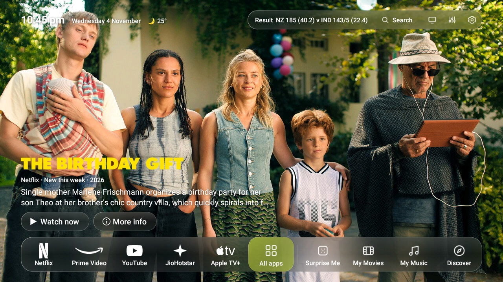

### Continue watching and My Watchlist

No more opening every app to find where you left off. Press Down and everything you're in the middle of, from your streaming apps and your own drive, appears as tall covers with how far you've got. Press OK for the details: the cover, the story and clear buttons for **Resume**, **Start over**, **More info**, **Mark watched**, **Remove from row** and **Fix picture**. Down again shows My Watchlist. Finished titles drop off by themselves, and a title with no cover still gets a card of its own.

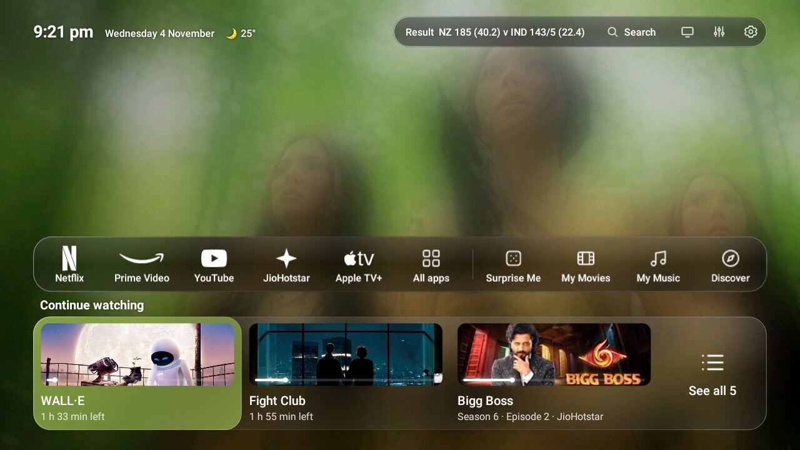

### Calm and smooth

Shiny black pages, a clear glass highlight that lands at once, and a dock whose highlight glides from app to app in each app's own colour: red on Netflix, blue on Prime Video.

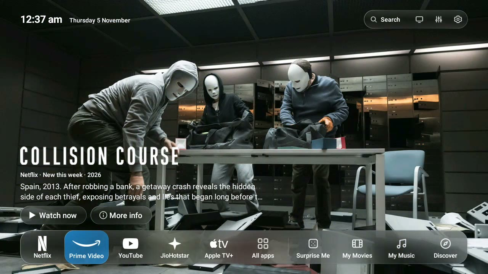

## Search

One search for films, series, songs, apps and YouTube, on a keyboard made for the remote.

### Search everything

No more pecking at letters with the arrows. The keyboard is laid out for a remote, or press **Type on your phone** and type there instead. Results come with pictures, and you can narrow them to your drive, streaming, music or apps. **Search in Netflix** (and any other app that takes a search) sends your words straight into that app.

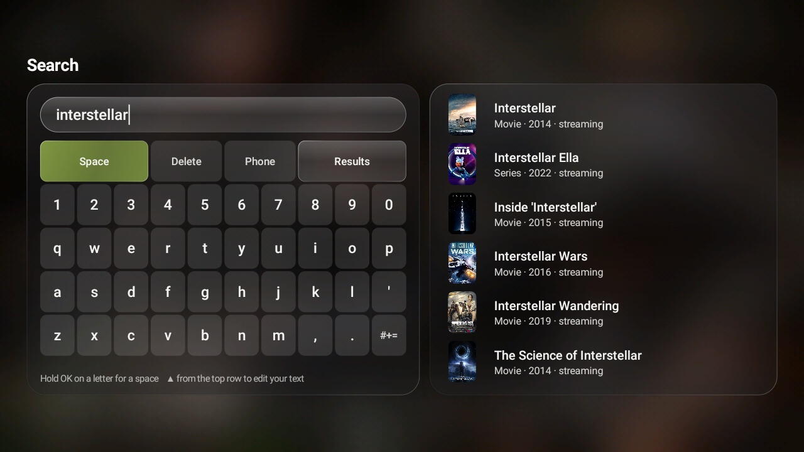

## Surprise Me

No more "What should we watch tonight?" Pick a mood and let TV Town find the right movie, series or song for you, only on the apps you have.

### Movie moods

Comedy, romance, thrillers, family nights, award winners and more, each with a big picture of its own, in the languages you choose.

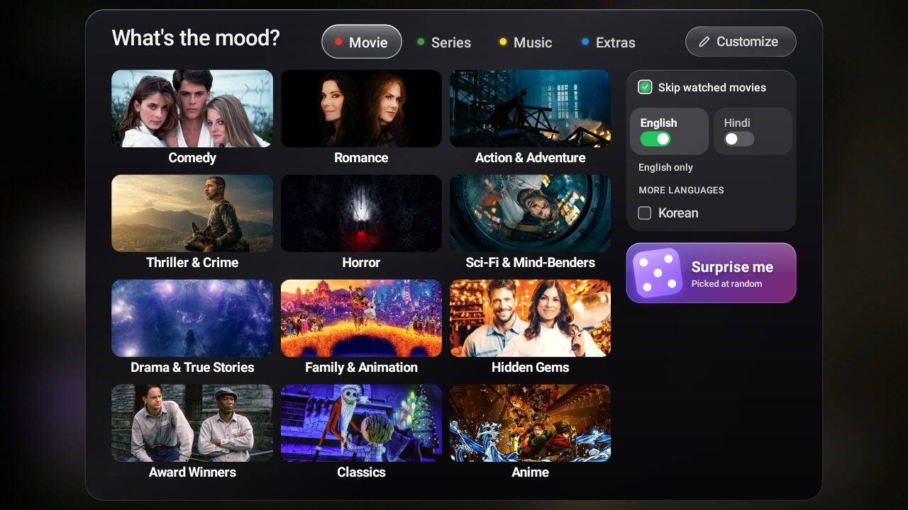

### Series moods

Binge-worthy shows, light comedies, gripping dramas and more.

### Music moods

Happy, romantic, party, chill, old favourites and new releases.

### Useful Extras

Recipes, Podcasts & Talks, Spirituality, Documentaries, Stand-up Comedy, Short Films, Cartoons, Classic TV Shows, Free Full Movies, Live News, Ambient & Relax and Trailers.

### Tick what you like

Find recipes by picking your diet, cuisine and meal, no typing needed: Veg, Jain, Vegan or Non-veg, Indian or Italian, breakfast or dinner, quick ones under 20 minutes. Podcasts, Spirituality and Documentaries work the same way with topics. **+ Add** your own ("Kerala fish curry", "Huberman Lab") and get matching videos instantly. Your ticks are remembered.

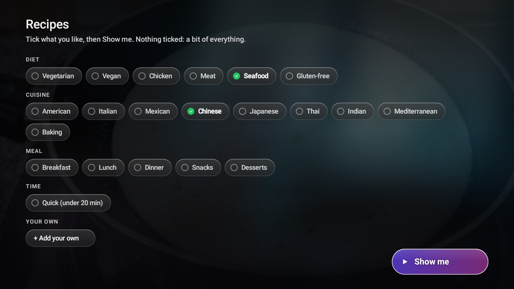

### Your picks

Big covers with the name, app, year and rating. Just press Play, shuffle for new picks, or open one to read about it first.

### A page for every title

The story and cast, with Play, Trailer, My List, Watched and Rate. Play opens right on the title in Netflix, Prime Video or JioHotstar.

## My Movies

Have your own movie collection? Plug in your pen drive or hard disk and My Movies turns it into a beautiful library.

### Big covers

Every film and series with its poster, name, year and rating, found for you automatically.

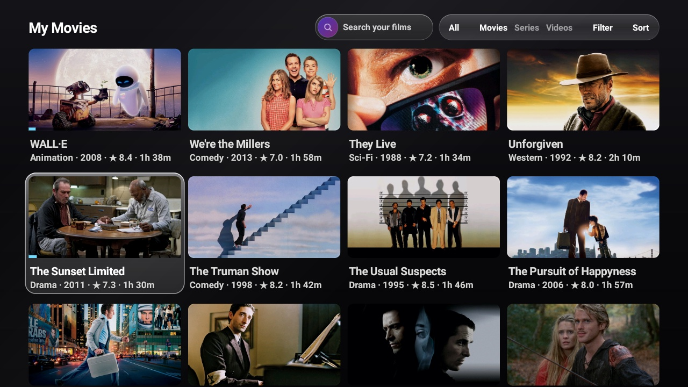

### Film page

Play or resume, the trailer, favourites, watched marks and your own rating, plus the audio and subtitle languages in the file. Tidy up right there too: rename, move or copy a film, or delete it, and its subtitles go with it.

### Filter

Automatic genre categories, plus mood and language, each with a count.

## My Music

Sing along on your TV. A music player with cool visualizer effects and karaoke-style lyrics, and it keeps playing on Home.

### Your collection

Every folder becomes a record, with its cover as the label. Browse by folder, artist, favourites or every song.

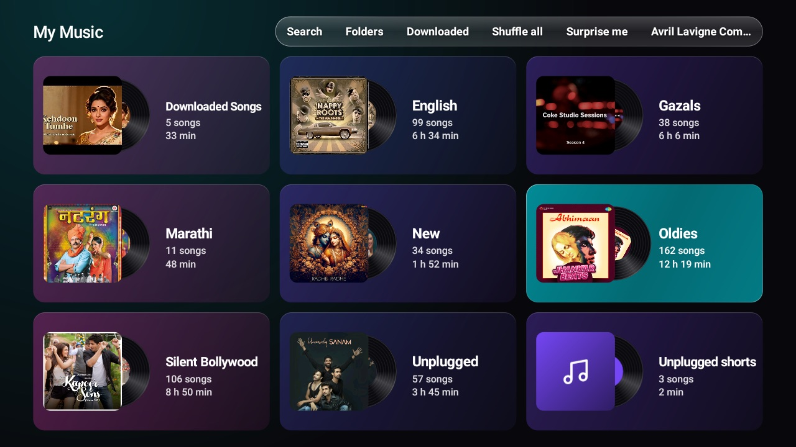

### Songs

Tidied names and covers, and a mark on the songs that have lyrics.

### Karaoke lyrics

The words fill in as the song plays, so singing along is easy.

### Hindi songs too

In Hindi script or English letters, whichever you read best.

### Moving scenes

Your own videos behind the words: mountains, rain, oceans and more.

## Music effects

Eleven visualizer effects that dance with the music, and can change by themselves as the song plays. Press Down for the player's controls: Lyrics, Look and Song.

 
 
 
 
 

## Discover

Movies and series from all your streaming apps in one place. No more jumping between apps to see what's new.

New, Trending, Top rated and Hidden gems, then every genre, from Anime and K-Drama to mixes like Action comedy. **Because you watched…** suggests titles like the last one you finished, **Coming up** shows what's arriving soon, and each of your apps gets a row of its own. Press Play and it opens right on the title in Netflix, Prime Video or JioHotstar.

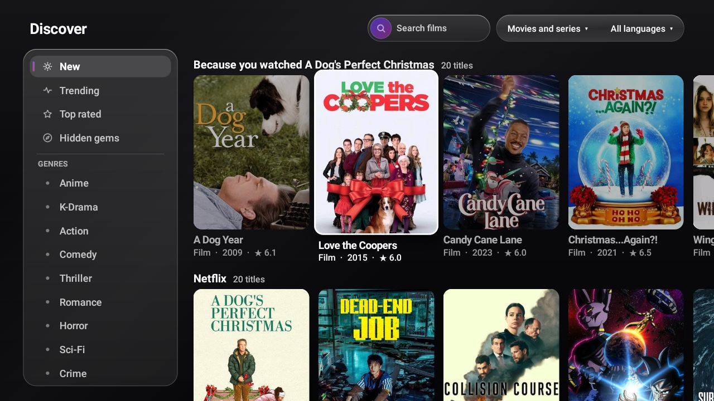

## Control Center and Sports

Your TV's quick controls one press away, and live scores for the sports you follow.

### Control Center

Sound and Bluetooth, inputs, sleep timer, speed test, Speed Up and setting TV Town as your home screen, all in one small panel from the top of Home.

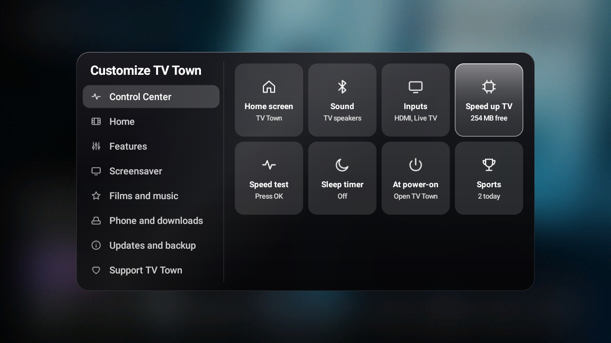

### Speed Up Your TV

One press switches off the TV's ad services, sponsored rows and background bloat, closes apps left running and turns on Lite mode. Nothing is uninstalled, and one button undoes it all.

- **Close apps left running:** apps you left behind, and Google's own home, which keeps running behind TV Town. The TV, its inputs and what's playing are never touched.
- **Switch off what the TV doesn't need:** only safe ones from TV Town's own short list (feedback senders, setup leftovers, ad services, sponsored rows), and the TV asks you before each one. Or pick apps one by one.
- **Lite mode:** TV Town drawn the quick way, so even a 1 GB TV feels quick.
- **Turn everything back on:** one button undoes it all.

It needs USB debugging on once, like the phone remote's arrows. The safe list was informed by the [CleanYourTV](https://github.com/Gathin23/cleanyourtv) project's tested lists for hundreds of TVs.

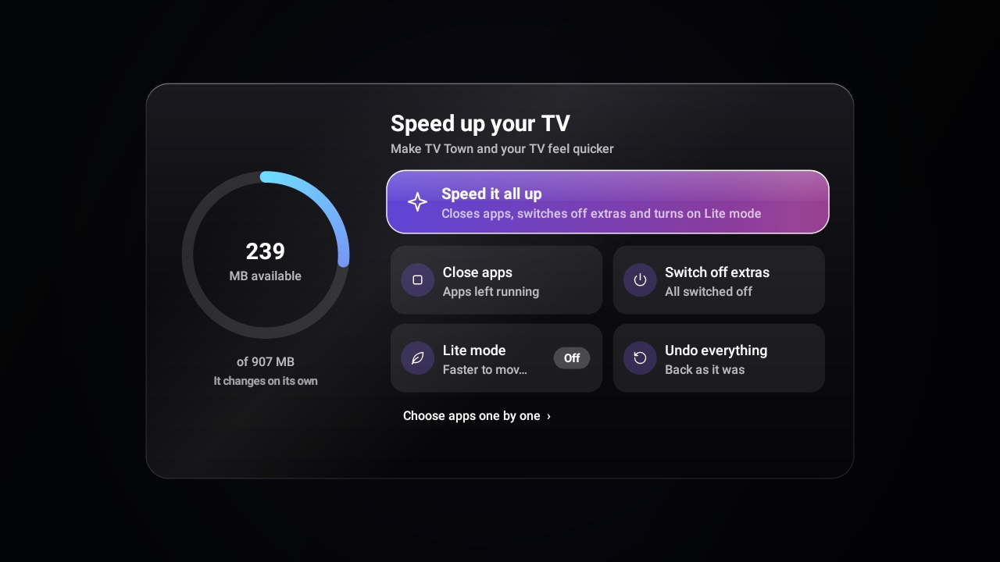

### Live Sports

Cricket, football, basketball and tennis: what's live now, coming up today and the latest results, each card in the teams' colours with their badges or flags.

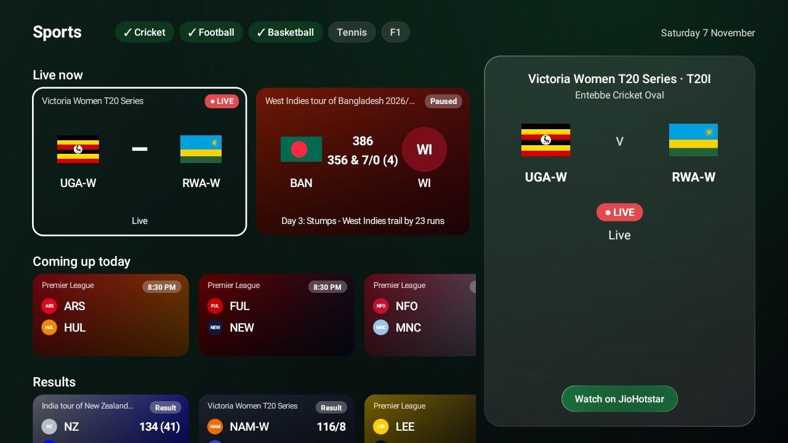

### Full scorecards

Press OK on a match for the whole story: every innings with each batter, how they got out, runs, balls, fours and sixes, the extras and every bowler. Football has possession, shots and goals as they happen. It keeps itself up to date while the match is live, and **Watch on** opens the app showing it.

## Phone remote

No more "pass me the remote!" Use your phone as a remote, with a built-in game controller. Nothing to install: scan the QR code on the TV and it opens right in your phone's browser, on iPhone or Android.

### Remote, Browse and Files

- **Remote:** your apps as tiles, playback, the coloured buttons, every app on the TV, and the TV's settings (Wi-Fi, Bluetooth, sound, picture) in one tap.
- **Browse:** Surprise Me, My Movies, My Music and the music player's buttons.
- **Files:** send files to the TV and get them back, and save from YouTube.
- **Always there:** search with your voice inside the app on the TV, what's playing, and big Home, Back, OK and volume keys. Dark or light, whichever you like.

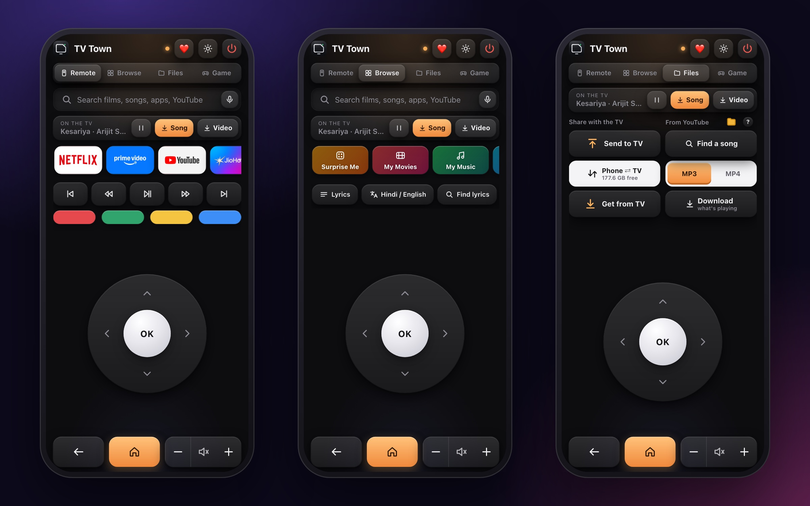

### Game controller

Hold your phone sideways for a thumb stick, D-pad, A B X Y, L1 L2 R1 R2, Select and Start, with a little buzz on each press. Steer and accelerate at the same time; most casual, arcade, racing and emulator games work.

## YouTube downloads

Save what's playing on YouTube, or any song by name, to your connected drive, and enjoy it offline.

- **MP3 or MP4:** just the song, or the video too.
- **From your phone:** tap Song or Video while YouTube plays on the TV, or Find a song by name or link.
- **With the TV remote:** press **OK twice** while a video plays. TV Town asks first, MP3 or Video, then Download or Cancel, so a stray press never saves anything.
- **Ready to play:** songs land in My Music and videos in My Movies, in the folders you choose.

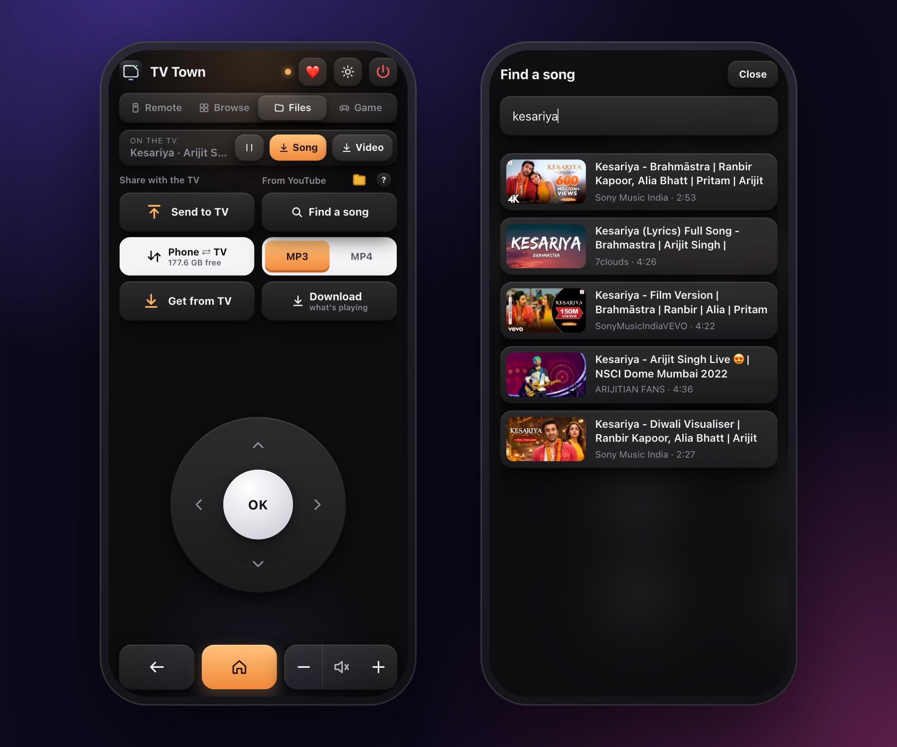

## Share

Move songs and films between your phone and your TV's drive, both ways. No cables, no cloud, no app to install.

- **Send to TV:** pick songs, films or subtitles on your phone. Songs go to Music and films to Movies by themselves.
- **Get from TV:** open a folder, tap a file, and it's on your phone.
- **LocalSend:** sending from a laptop or another phone? The free LocalSend app works too: open **Receive files** on the TV, then send.
- **Safe:** nothing is ever replaced, and half-sent files are never left behind.

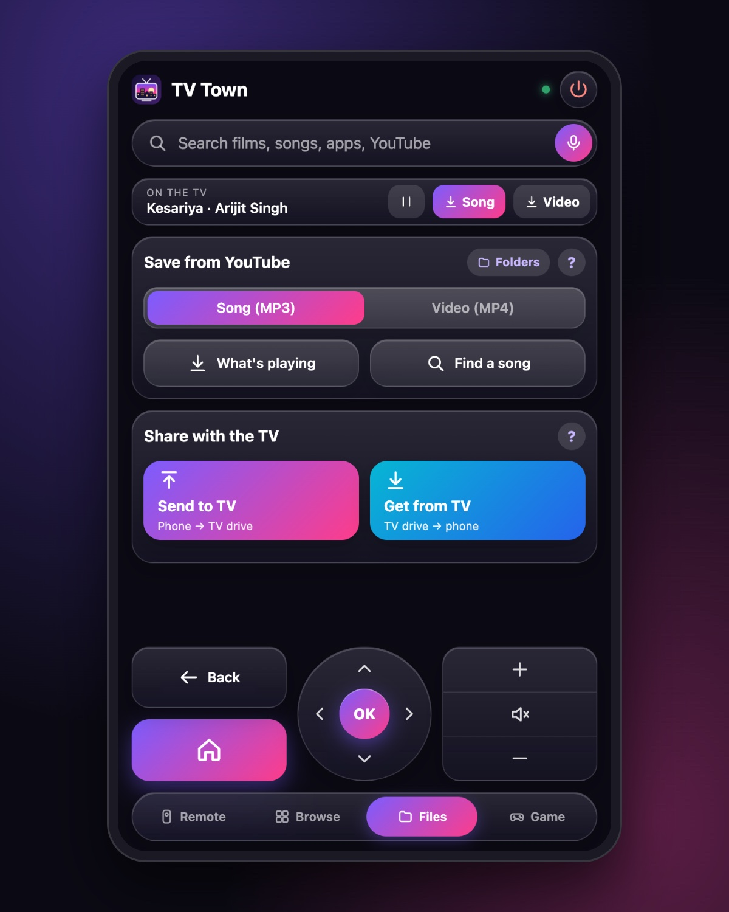

## Settings

Turn features on or off and set up TV Town exactly the way you like. **Customize TV Town** opens from the sliders at the top of Home.

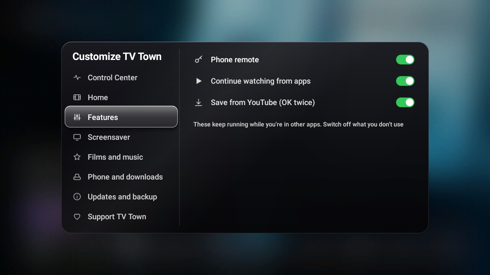

- **Home:** what the big picture shows, full screen or in a card, the apps on Home, your two top bar buttons, an icon pack, and the weather.
- **Features:** hide what you don't use, like Surprise Me, My Movies, My Music or live scores.
- **Films and music:** language (English or Español), the kind of picks, your streaming country and the languages you watch in. **Play films in** can open picks in [Stremio](https://www.stremio.com), [Nuvio](https://github.com/NuvioMedia/NuvioTV) or WuPlay instead of your streaming apps.
- **Phone and downloads:** connect your phone, receive files with LocalSend, and choose where saves go.
- **Updates and backup:** updates with what's new in each, and your whole setup backed up to one file to move it to another TV.

## Screensaver

Something beautiful when nobody's watching, dimmed at night. Pick one in **Customize → Screensaver** and **Try it now**:

- **Film pictures** from what's new on your apps
- **Picture of the day** from Wikimedia, and **Space and Earth** from NASA
- **A clock**, your own videos, [Aerial Views](https://play.google.com/store/apps/details?id=com.neilturner.aerialviews) (free, one button to get it), or any screensaver you have

### Film pictures

### Your videos

Put videos in a *TV Town Screensaver* folder on a drive, and they play with a drifting clock.

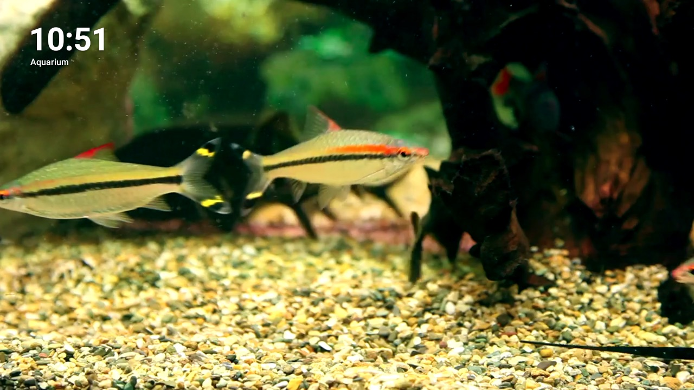
