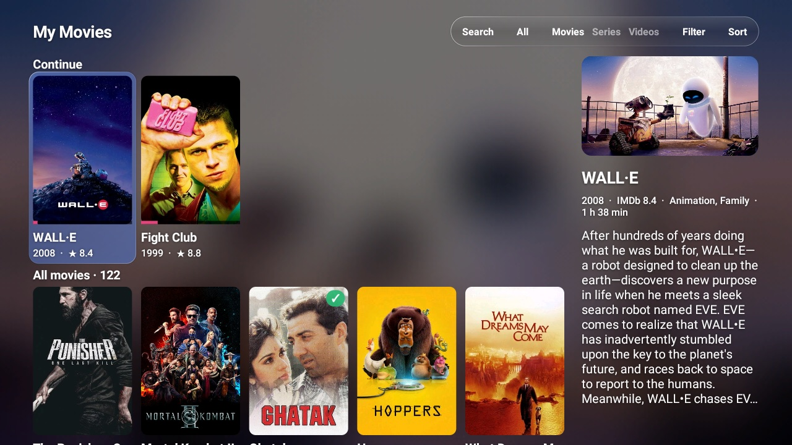
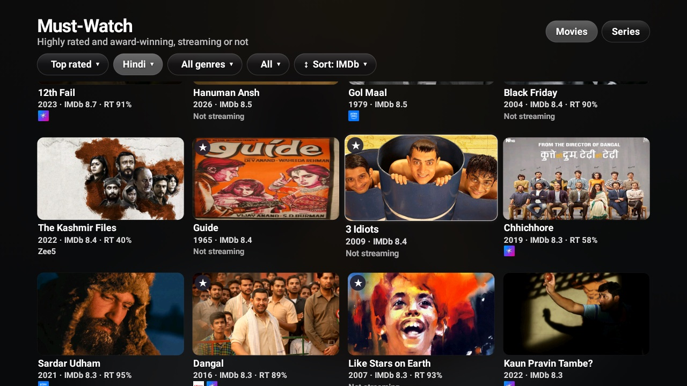
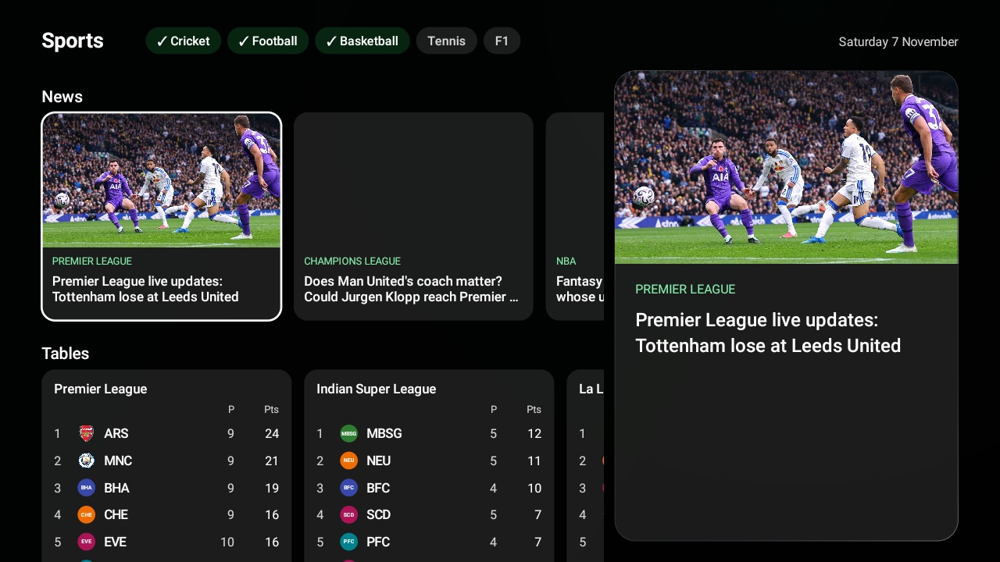
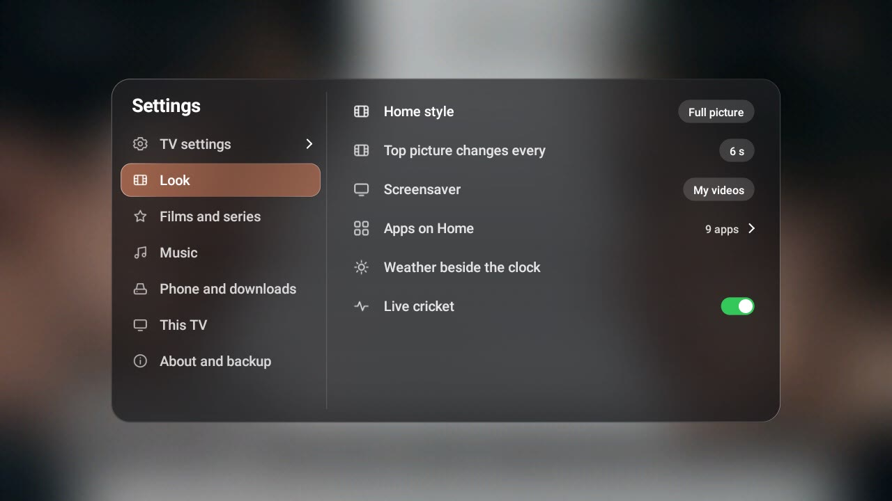
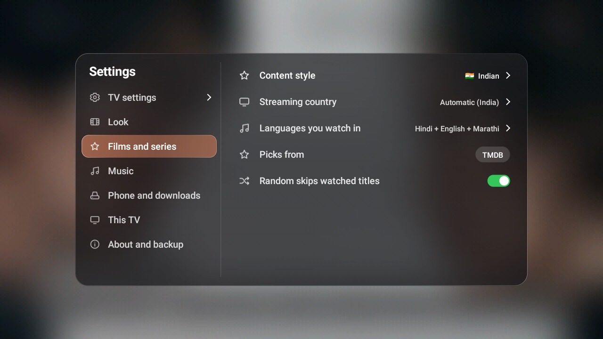
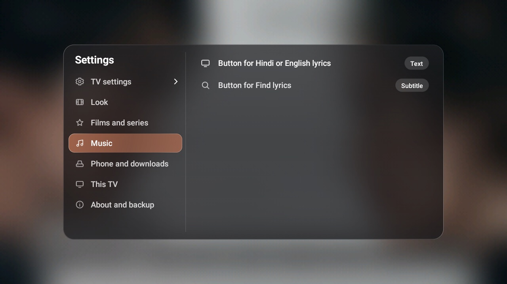
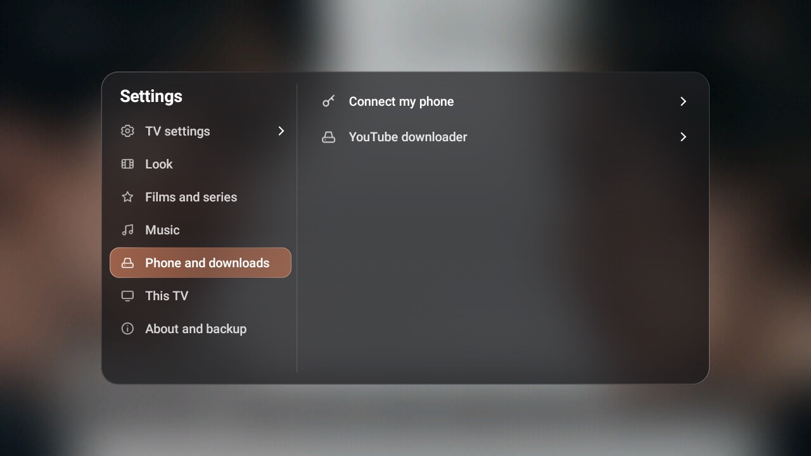
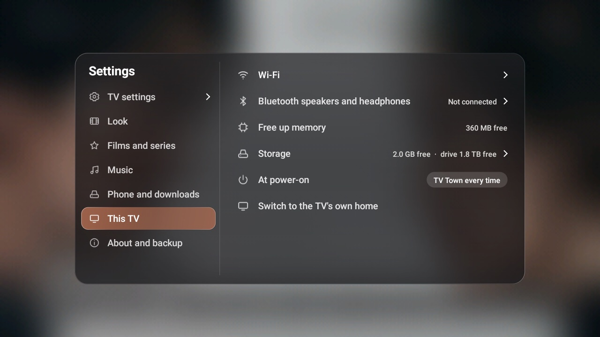
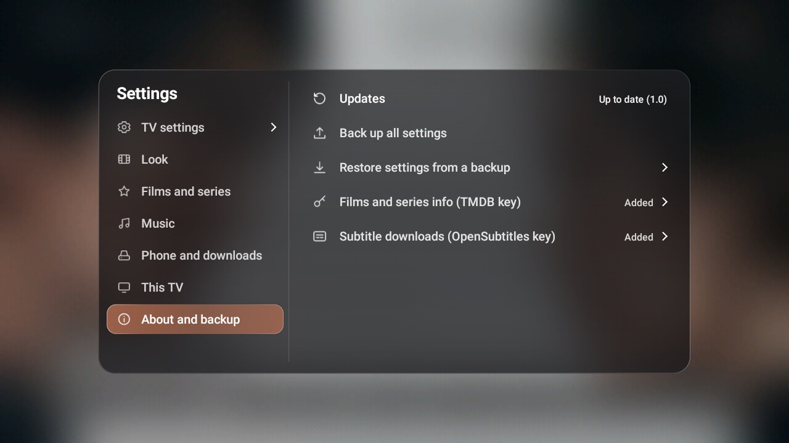

# TV Town Launcher: every feature

Watch [the video](https://github.com/NareshJagriya/tv-town-launcher/releases/latest/download/TV-Town-Launcher-video.mp4), or browse by feature:

- [Home](#home)
- [Search](#search)
- [Surprise Me](#surprise-me)
- [My Movies](#my-movies)
- [My Music](#my-music)
- [Music effects](#music-effects)
- [Discover and Must-Watch](#discover-and-must-watch)
- [Control Center and Sports](#control-center-and-sports)
- [Phone remote](#phone-remote)
- [YouTube downloads](#youtube-downloads)
- [Share](#share)
- [Settings](#settings)
- [Screensaver](#screensaver)

## Home

The whole screen shows what's new this week on your apps. Everything else floats above it on glass.

### Full-picture Home

The newest titles on your apps, with their logos, a summary, Watch now and More info. A glass dock holds your apps and shortcuts, and the top bar has the time, weather, live score, Search and Settings.

### Continue watching

Press Down for up to 15 things you're in the middle of, with the time left on each: films from your own drive, and what you were watching in Netflix, YouTube, Prime Video, JioHotstar and other apps. Music and short clips are left out, and anything you finish drops off.

### Glass and smooth movement

Every panel is frosted glass over the picture behind it. The highlight glides from item to item as you move: red on Netflix, blue on Prime Video, and each app in its own colour. Menus pick up their colour from the picture behind them.

## Search

One place to look for anything, on a keyboard made for the remote.

### Search everything

Films, series, songs, apps and YouTube together, with pictures in the results and your recent searches. You can also type on your phone.

## Surprise Me

For when you can't decide what to watch or hear.

### Movie moods

A colourful tile for each mood, in the languages you choose.

### Series moods

Comedy, thrillers, drama, binge-worthy shows and more.

### Music moods

Happy, romantic, party, chill, old favourites and new releases.

### Extras

Trailers, stand-up, classic TV shows, cartoons, highlights and free full movies.

### Your picks

One big pick and a row of more, only on the apps you have. Play it, see more, watch the trailer or get new picks.

### A page for every title

The story and cast, with Play, Trailer, My List, Watched and Rate.

## My Movies

Plug in a drive and your films become a cinema.

### Big covers

Every film and series with its poster, name, year and rating, and a small preview with the full details beside them.

### Continue, and everything else

What you started comes first, with a bar showing how far you got.

### Film page

Audio and subtitle languages from the file, Play, Trailer, Favourite, Watched, Rate, Tags, Subtitles and Fix match.

### Filter

By genre, mood and language, with a count beside each.

## My Music

Your songs as a record collection, with a player that keeps going on Home.

### Your collection

Every folder as a record with its cover, plus Search, Downloaded, Shuffle all and Surprise me.

### Songs

Tidied names and covers, artists, albums and which songs have lyrics.

### Karaoke lyrics

Words fill in as they are sung, here over a music effect.

### Hindi songs too

In Hindi script or English letters.

### Moving scenes

Videos from your own drive behind the words: mountains, rain, oceans and more.

## Music effects

Eleven effects that move with the music. They can change by themselves as the song plays.

 
 
 
 
 

## Discover and Must-Watch

Find something worth watching.

### Discover

Shelves of big covers for New on your apps, Popular on each app, Top rated, Award winners, Critics' picks and moods, with a small preview. Choose movies or series, and a language.

### Must-Watch

The best rated and award-winning titles, with IMDb and Rotten Tomatoes scores, and which app has each one.

## Control Center and Sports

Live scores for the sports you follow, and the things you reach for one press away.

### Control Center

What's playing, Sleep timer, Speed test, Sound, Free memory, Sports and Turn off, on one small card.

### Sports home

Pick your sports at the top: cricket, football (Premier League, Champions League, ISL, La Liga, World Cup), basketball (NBA), tennis and Formula 1. Rows show what's live now, coming up today, and results, each card in the two teams' colours with their badges or flags. The card on the right follows you as you move.

### Live scorecards and stats

A match's card has the big score, the ground and the latest: cricket's batting and bowling cards, or football's possession, shots, corners and fouls, with goals and cards as they happen. It refreshes every 30 seconds while the match is live. Watch on opens the app showing it.

### News and tables

Headlines with photos from the sports you follow, shown large as you move onto them, and the top of each league's table with badges and points.

## Phone remote

Your phone becomes the remote and a game controller, with nothing to install. Frosted glass, and every tab fits on one screen.

### Remote, Browse and Files

- **Always there:** a Search bar with a mic that searches inside the app on the TV (YouTube, Netflix, Prime Video, JioHotstar…) or in TV Town; what's playing with Song and Video download buttons; and at the bottom Back, a big Home, the arrows with OK, and volume with Mute.
- **Remote:** your five main apps and All apps as big tiles, then Surprise Me, My Movies and My Music, playback and the coloured buttons.
- **Browse:** TV Town Home, every TV Town place, and the music player's and TV's buttons.
- **Files:** save from YouTube and share with the TV (see below), with a Folders button for where saves go.

Works on iPhone and Android, on your home Wi-Fi. Every keyboard on the TV also shows a small QR code to type on your phone.

### Game controller

Hold your phone sideways: a thumb stick, D-pad, A B X Y, L1 L2 R1 R2, Select and Start, with a small buzz on each press. Several buttons can be held at once, so you can steer and accelerate together. Most casual, arcade, racing and emulator games work; a few only accept a Bluetooth controller.

## YouTube downloads

Save any song or video to your own drive, from your phone or with the TV remote, while it keeps playing.

- **Audio or video:** MP3 for songs, MP4 to keep the picture.
- **What's playing, a name or a link:** tap Song or Video while YouTube plays on the TV, or Find a song to search by name or paste a YouTube link.
- **Your choice of folder:** songs and videos each go where you choose, ready in My Music and My Movies.
- **On the TV too:** press **OK twice** quickly while a YouTube video plays (it blinks and carries on), or pause it and press the red button. It saves in the background, even with your phone closed.
- **Help** is one tap away on the page.

## Share

Move files between your phone and the drive plugged into the TV, over Wi-Fi, with no cables, cloud or app.

- **Send to TV:** pick songs, films or subtitles on your phone. Songs go to Music and films to Movies by themselves, or choose a folder.
- **Get from TV:** open a folder and tap a file to save it on your phone.
- **Safe:** nothing is ever replaced, and half-sent files are never left behind.
- **Help** is one tap away on the page.

## Settings

A small glass card, with the TV's own settings at the top.

### Look

Home style, how often the picture changes, screensaver, apps on Home, weather and live scores.

### Films and series

Content style, streaming country, languages and where picks come from.

### Music

Buttons for lyrics.

### Phone and downloads

Connect your phone, and set up the YouTube downloader.

### This TV

Wi-Fi, Bluetooth, memory, storage and what opens at power-on.

### About and backup

Updates, backup and restore, and your free keys.

## Screensaver

Beautiful when nobody is watching, and dimmed at night.

### Your videos

From a folder on your drive, with a drifting clock.

### Film pictures

Or the pictures from what's new on your apps.

