# TV Town Launcher: every feature

Watch [the video](https://github.com/NareshJagriya/tv-town-launcher/releases/latest/download/TV-Town-Launcher-video.mp4), or browse by feature:

- [Home](#home)
- [Search](#search)
- [Surprise Me](#surprise-me)
- [My Movies](#my-movies)
- [My Music](#my-music)
- [Music effects](#music-effects)
- [Discover](#discover)
- [Control Center and Sports](#control-center-and-sports)
- [Phone remote](#phone-remote)
- [YouTube downloads](#youtube-downloads)
- [Share](#share)
- [Settings](#settings)
- [Screensaver](#screensaver)

## Home

The whole screen shows what's new this week on your apps. Everything else floats above it on glass.

### Full-picture Home

The newest titles on your apps, with their logos, a summary, Watch now and More info. A glass dock holds your apps and shortcuts, and the top bar has the time, weather, live score, Search and Settings.

### Continue watching

Press Down for up to 15 films and series you're in the middle of, with the time left on each: from your own drive, and from Netflix, Prime Video, JioHotstar and other apps. Each cover shows how far you've got, and on the dock an app with something half-watched shows its latest above it. When there are more than fit, **See all** opens one low row of cards that slides sideways. YouTube, music and short clips are left out, and anything you finish drops off.

### Glass and smooth movement

Pop-ups and pages are shiny black, and whatever you are on is a pane of clear glass that lands at once, with no trail. Lists lift the chosen row a little. Main buttons (Play, Speed it all up, Surprise me) are a deep violet jewel, and every tick and switch is green. On the dock the highlight glides from app to app in each app's own colour: red on Netflix, blue on Prime Video.

## Search

One place to look for anything, on a keyboard made for the remote.

### Search everything

Films, series, songs, apps and YouTube together, with pictures in the results and your recent searches. A row above the results narrows them to All, Your drive, Streaming, Music or Apps, and "Search in Netflix" (and every other app that takes a search) sends your words straight to that app. The keyboard has Delete, Space and Search on top, Clear all, capitals and Search at the foot, and **Type on your phone** to type with your phone instead.

## Surprise Me

For when you can't decide what to watch or hear.

### Movie moods

A colourful tile for each mood, in the languages you choose.

### Series moods

Comedy, thrillers, drama, binge-worthy shows and more.

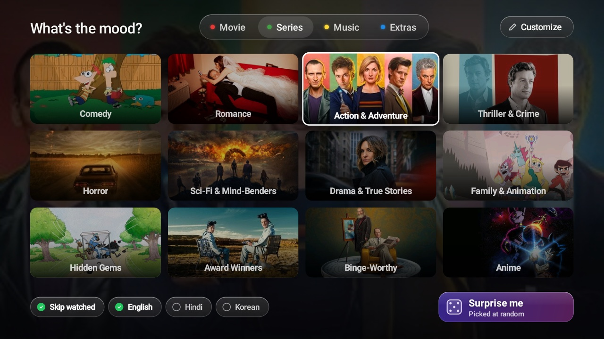

### Music moods

Happy, romantic, party, chill, old favourites and new releases.

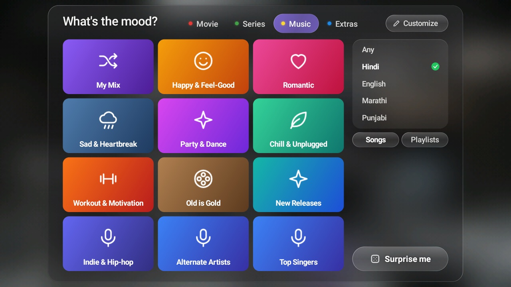

### Extras

Trailers, stand-up, classic TV shows, cartoons, highlights and free full movies.

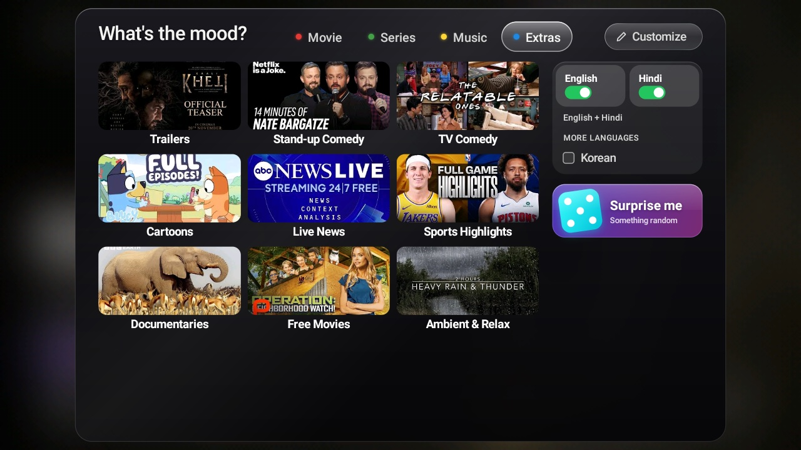

### Your picks

One big pick and a row of more, only on the apps you have. Play it, see more, watch the trailer or get new picks.

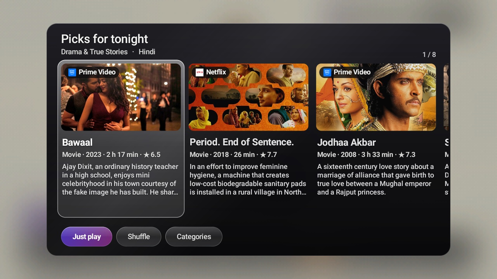

### A page for every title

The story and cast, with Play, Trailer, My List, Watched and Rate.

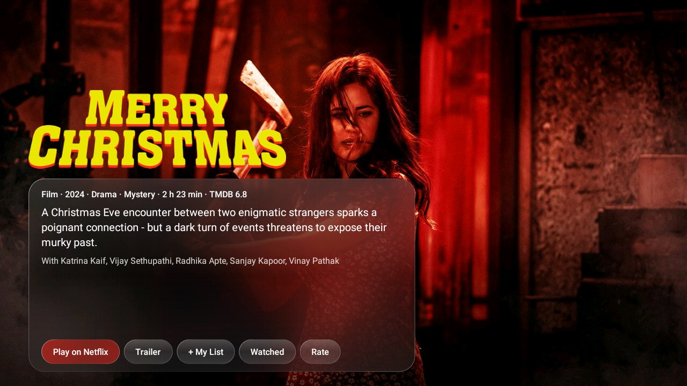

## My Movies

Plug in a drive and your films become a cinema.

### Big covers

Every film and series with its poster, name, year and rating, and a small preview with the full details beside them.

### Film page

Audio and subtitle languages from the file, Play, Trailer, Favourite, Watched, Rate, Tags, Subtitles and Fix match.

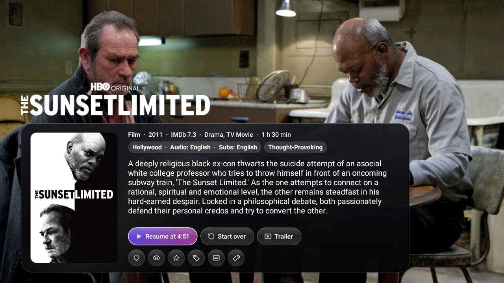

### Filter

By genre, mood and language, with a count beside each.

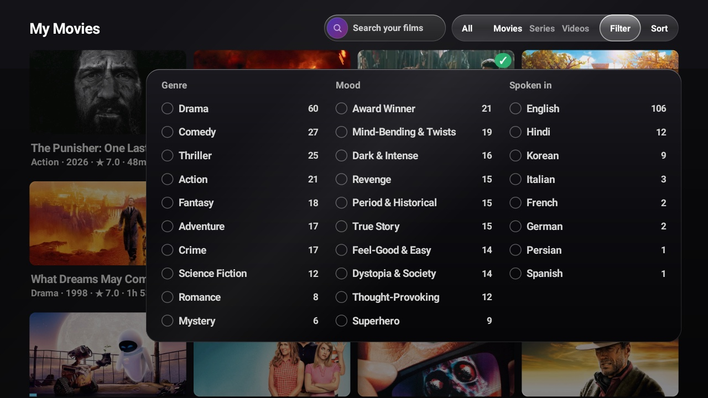

## My Music

Your songs as a record collection, with a player that keeps going on Home.

### Your collection

Every folder as a record with its cover as the label. A search bar at the top, and Show for Folders, Artists, All songs, Favourites and Downloaded.

### Songs

Tidied names and covers, artists, albums and which songs have lyrics.

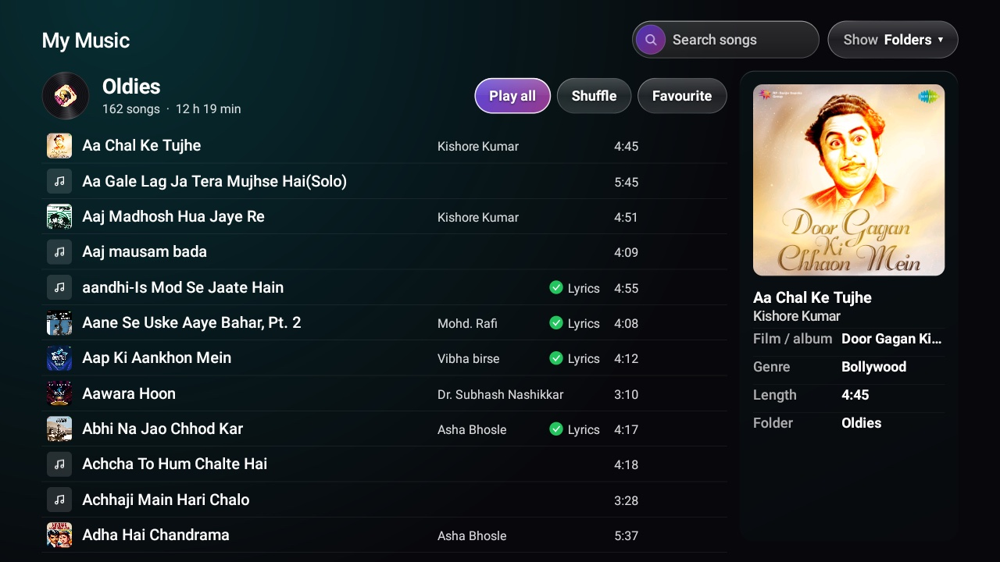

### Karaoke lyrics

Words fill in as they are sung, here over a music effect.

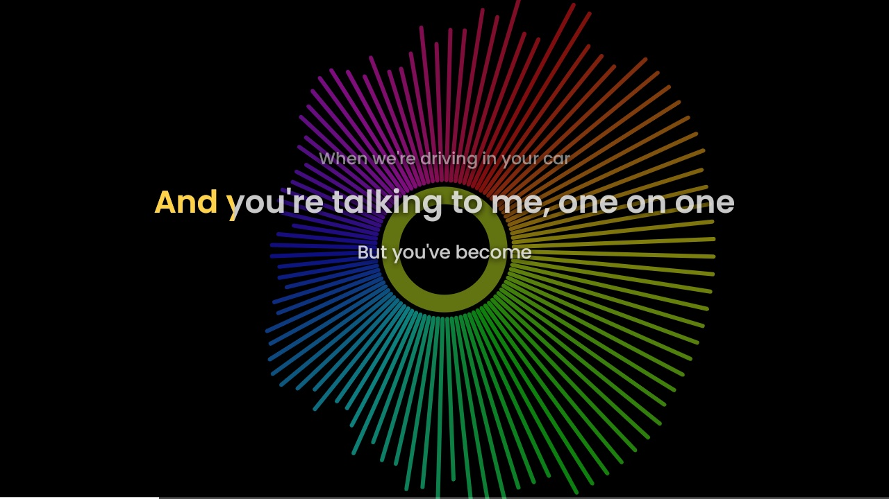

### Hindi songs too

In Hindi script or English letters.

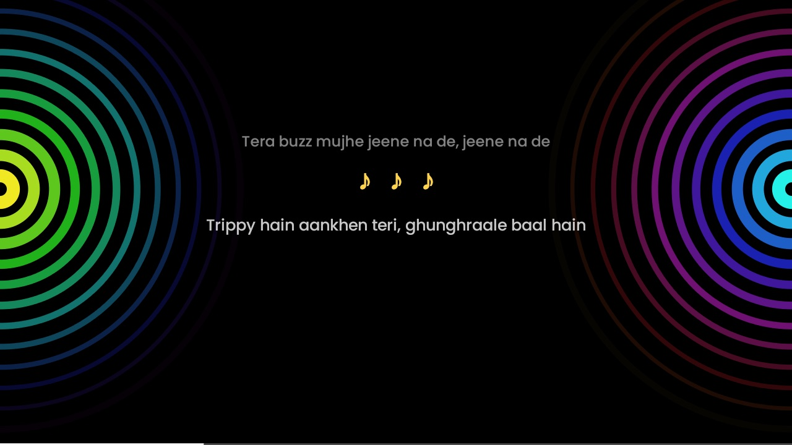

### Moving scenes

Videos from your own drive behind the words: mountains, rain, oceans and more.

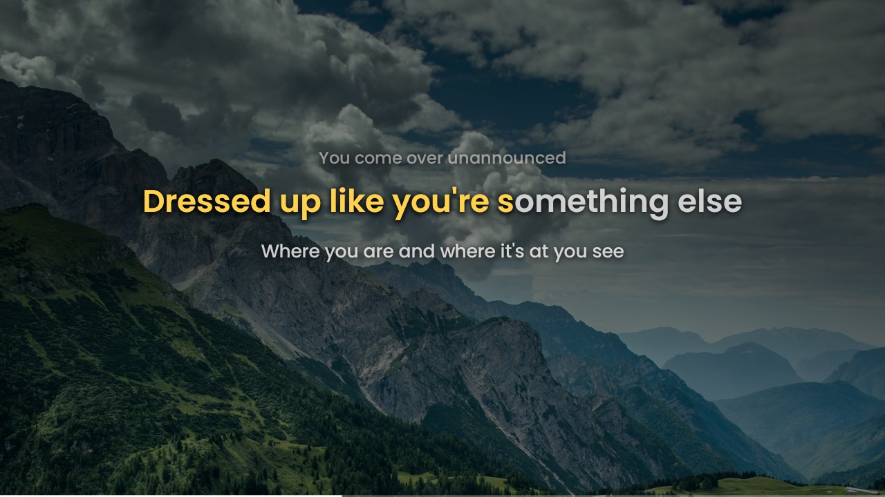

## Music effects

Eleven effects that move with the music. They can change by themselves as the song plays.

 
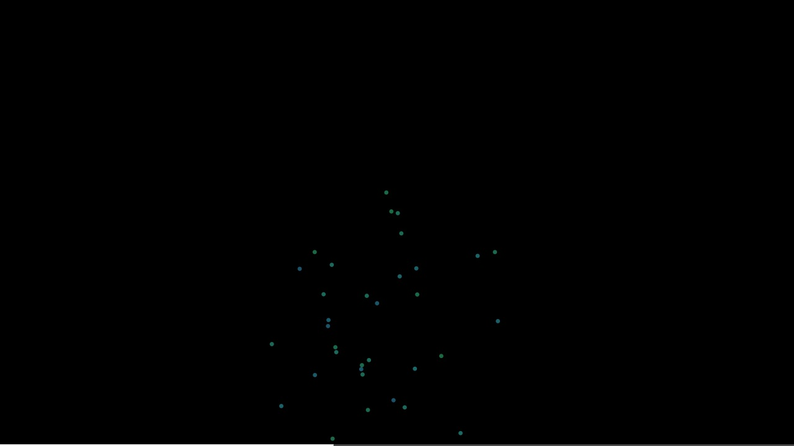 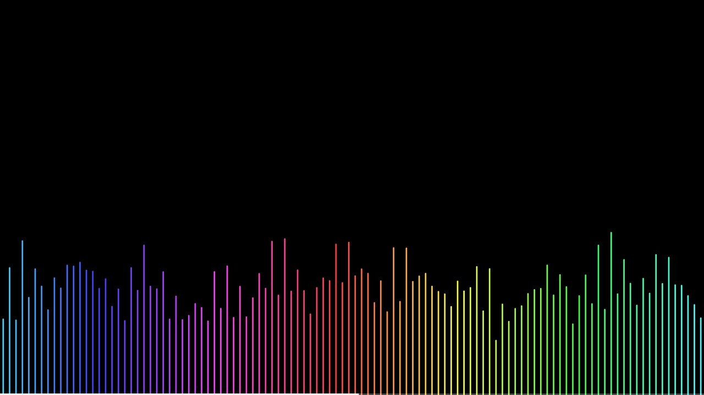
 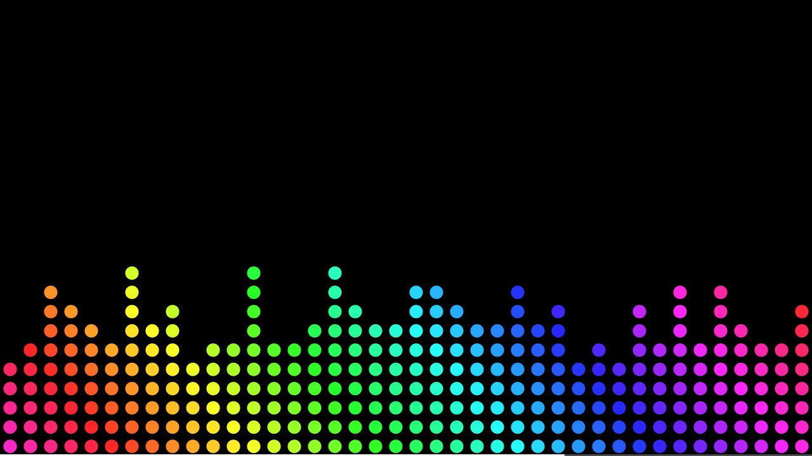
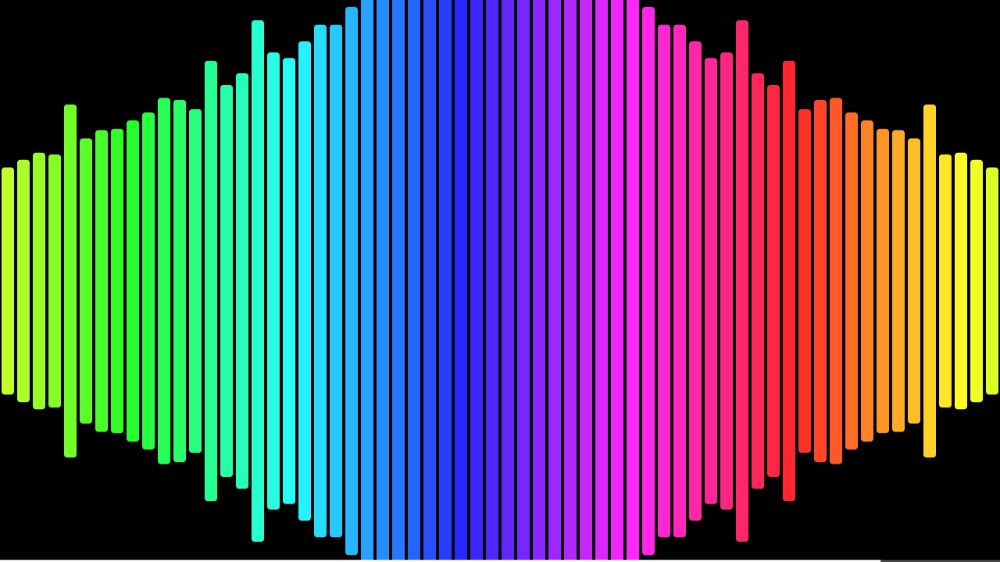 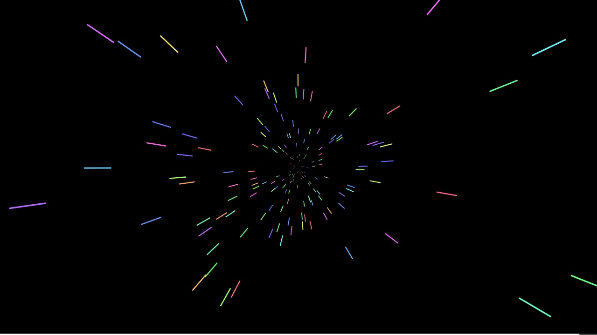
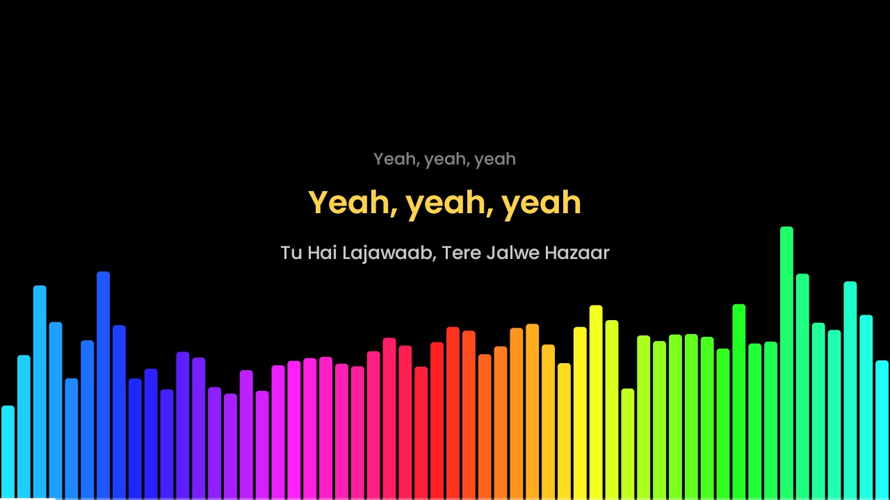 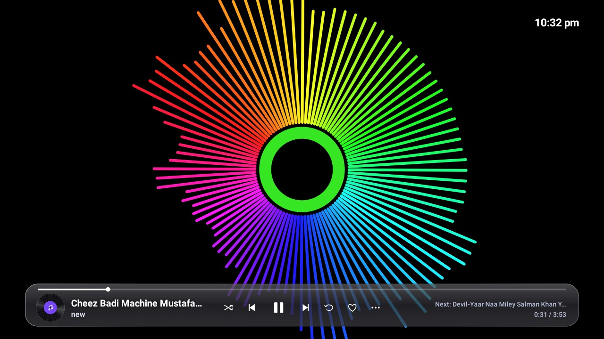

## Discover

Find something worth watching.

One list down the left: New, Trending, Top rated and Hidden gems, then the genres, Anime and K-Drama among them, and mixes like Action comedy. On the right, a row for each of your apps: four covers in view, each with its name, year and rating, sliding sideways for more. Right always goes to the covers and Left back to the list. Movies, series or both, and a language, drop down from the top.

## Control Center and Sports

Live scores for the sports you follow, and the things you reach for one press away.

### Control Center

The TV's quick controls, most needed first: Home screen (set TV Town up as the home, or go back to the TV's own), Sound (Bluetooth speakers and headphones), Inputs, Speed up TV; then Speed test, Sleep timer, At power-on and Sports. First in Customize TV Town (the sliders at the top of Home).

### Speed up your TV

How much memory is available, one big **Speed it all up** button, and its parts on their own:

- **Close apps left running:** apps you left, and Google's own Home, which keeps running behind TV Town. The TV itself, its inputs and the app playing are never touched. A few, like the Play Store, the TV starts again by itself.
- **Switch off what the TV doesn't need:** only safe ones (feedback senders, setup leftovers, ad services, sponsored rows). Right shows every app to choose one by one, with what it uses now; Google Assistant, Chromecast built-in, YouTube Music and a few more are there too, each saying what stops working.
- **Lite mode:** TV Town drawn the quick way: glass in a soft tint of the picture's own colour instead of the blurred picture, no animations, Home's picture in a card that changes only when you move, smaller pictures, and My Music's effects off. Nothing is removed.
- **Turn everything back on:** the apps TV Town switched off, and Lite mode off.

Nothing is uninstalled: switching off uses Android's own "disable", and **Turn all back on** undoes everything TV Town switched off. Only apps on TV Town's own short list can be switched off, never what the TV needs (its Live TV and inputs, keyboard, setup, Google Play, the remote's pairing, its settings), and the TV is asked again before each one. It needs USB debugging on once, like the phone remote's arrows. The list was informed by the [CleanYourTV](https://github.com/Gathin23/cleanyourtv) project's tested lists for hundreds of TVs.

### Sports home

Pick your sports at the top: cricket, football (Premier League, Champions League, ISL, La Liga, World Cup), basketball (NBA), and tennis. Rows show what's live now, coming up today, and results, each card in the two teams' colours with their badges or flags. The card on the right follows you as you move; OK (or Right at the end of a row) steps onto it, to **Watch on** the app showing it or open the **Full scorecard**.

### Live scorecards and stats

A match's card has the big score, the ground and the latest: cricket's batting and bowling cards, or football's possession, shots, corners and fouls, with goals and cards as they happen. It refreshes every 30 seconds while the match is live. Watch on opens the app showing it.

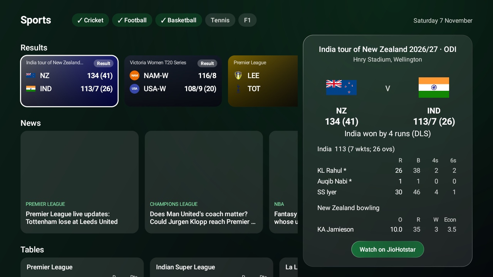

## Phone remote

Your phone becomes the remote and a game controller, with nothing to install. Frosted glass, and every tab fits on one screen.

### Remote, Browse and Files

- **Always there:** a Search bar with a mic that searches inside the app on the TV (YouTube, Netflix, Prime Video, JioHotstar…) or in TV Town; what's playing with Song and Video download buttons; and at the bottom Back, a big Home, the arrows with OK, and volume with Mute.
- **Remote:** your five main apps and All apps as big tiles, then Surprise Me, My Movies and My Music, playback and the coloured buttons.
- **Browse:** TV Town Home, every TV Town place, and the music player's and TV's buttons.
- **Files:** save from YouTube and share with the TV (see below), with a Folders button for where saves go.

Works on iPhone and Android, on your home Wi-Fi. Every keyboard on the TV has a **Type on your phone** key that shows a QR code to type on your phone.

### Game controller

Hold your phone sideways: a thumb stick, D-pad, A B X Y, L1 L2 R1 R2, Select and Start, with a small buzz on each press. Several buttons can be held at once, so you can steer and accelerate together. Most casual, arcade, racing and emulator games work; a few only accept a Bluetooth controller.

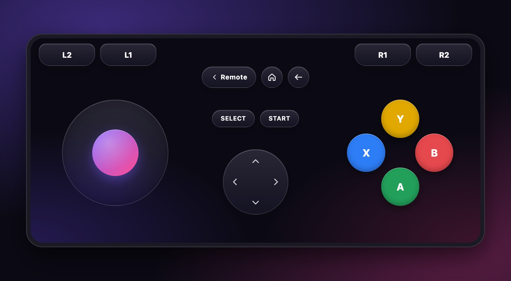

## YouTube downloads

Save any song or video to your own drive, from your phone or with the TV remote, while it keeps playing.

- **Audio or video:** MP3 for songs, MP4 to keep the picture.
- **What's playing, a name or a link:** tap Song or Video while YouTube plays on the TV, or Find a song to search by name or paste a YouTube link.
- **Your choice of folder:** songs and videos each go where you choose, ready in My Music and My Movies.
- **On the TV too:** press **OK twice** quickly while a YouTube video plays (it blinks and carries on). It saves in the background, even with your phone closed.
- **Help** is one tap away on the page.

## Share

Move files between your phone and the drive plugged into the TV, over Wi-Fi, with no cables, cloud or app.

- **Send to TV:** pick songs, films or subtitles on your phone. Songs go to Music and films to Movies by themselves, or choose a folder.
- **Get from TV:** open a folder and tap a file to save it on your phone.
- **Safe:** nothing is ever replaced, and half-sent files are never left behind.
- **Help** is one tap away on the page.

## Settings

**Customize TV Town** opens from the sliders at the top of Home; the gear opens the TV's own settings. Lists with more than two choices open as a small pop-up.

### Home

Top picture (full screen or in a card), apps on Home, weather and live scores.

### Features

Switch off the parts that keep running while you're in other apps: the phone remote, Continue watching from apps, and saving from YouTube with OK twice. Everything else only loads when you open it.

### Films and music

Content style, streaming country, languages and where picks come from.

### Phone and downloads

Connect your phone, choose where songs and videos are saved, and see how much storage is free.

### Updates and backup

Updates, backup and restore, and your free keys.

## Screensaver

Beautiful when nobody is watching, and dimmed at night. In **Settings → Screensaver**, one list: TV Town's **film pictures** (from what's new on your apps) or **clock**, nothing to set up; [Aerial Views](https://play.google.com/store/apps/details?id=com.neilturner.aerialviews) (free, one button to get it); or any other screensaver you have. **Try it now** starts it straight away.

### Film pictures

The pictures from what's new on your apps. Works straight away.

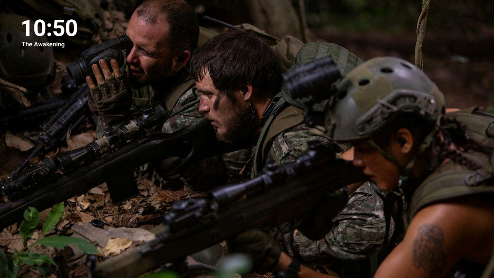

### Your videos (optional)

Put videos in a *TV Town Screensaver* folder on a drive and they appear in the list, with a drifting clock.

