# TV Town Launcher

**Clear the clutter and give your Android TV a premium, cinema-like home screen.**

Version 1.3 · Android TV and Google TV 9 and later · runs well on a 1 GB TV

**Install it in a minute:** on your TV, get **Downloader** from the Play Store and enter the code **9356599**. [Step-by-step guide →](INSTALL.md) Updates come from inside TV Town.

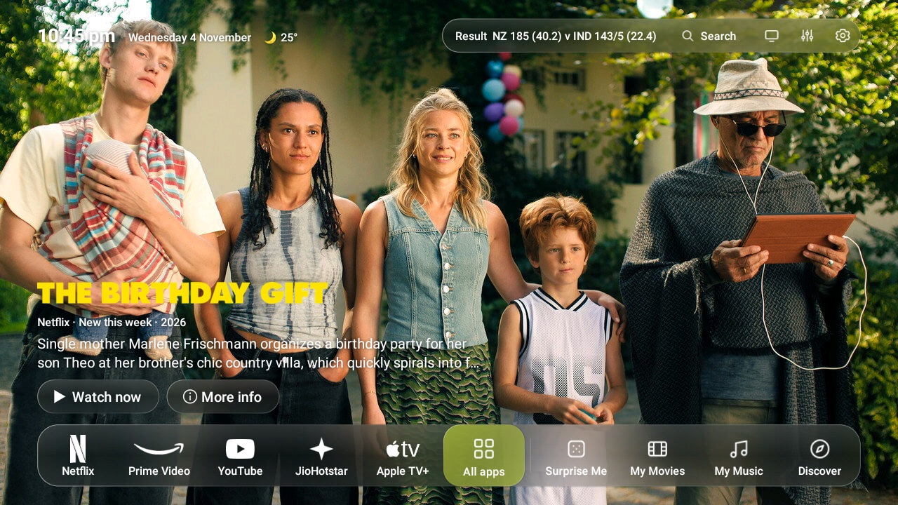

**[Watch the video](https://github.com/NareshJagriya/tv-town-launcher/releases/latest/download/TV-Town-Launcher-video.mp4)** · **[See every feature with pictures](FEATURES.md)**

---

## ✨ What makes it special

- 🖼️ **Cinematic Home:** Clear the clutter and give your TV a premium, cinema-like feel. Full-screen artwork from the apps you actually use, with no ads or sponsored rows.
- 🚀 **Speed Up Your TV:** One press switches off the TV's ad services, sponsored rows and background bloat, closes apps left running and turns on Lite mode. Nothing is uninstalled, and one button undoes it all.
- ⏯️ **Continue Watching:** No more opening every app to find where you left off. What you're in the middle of, from your streaming apps and your own drive, right on the Home screen.
- 🔍 **Discover:** Movies and series from all your streaming apps in one place: New, Trending, Top rated, Hidden gems and more. Press Play and it opens right on the title in Netflix, Prime Video or JioHotstar.
- 🎲 **Surprise Me:** No more "What should we watch tonight?" Pick a mood and let TV Town find the right movie for you.
- ⌨️ **Easy TV Keyboard:** A keyboard designed for typing with a remote, or type from your phone instead. One search for films, series, songs, apps and YouTube.
- 📱 **Free Phone Remote:** No more "pass me the remote!" Use your phone as a remote, with a built-in 🎮 game controller. Nothing to install: it opens right in your phone's browser.
- 🎬 **My Movies:** Have your own movie collection? My Movies turns your pen drive or hard disk into a beautiful library with posters, ratings and automatic genre categories.
- 🎵 **Sing Along:** A music player with cool visualizer effects and karaoke-style lyrics that fill in as the song plays, so singing along is easy.
- 🏏 **Live Sports:** Cricket, football, basketball and tennis, with live scores, full scorecards and match stats.
- 🔄 **Share:** Move songs and films between your phone and your TV's drive, both ways. No cables, no cloud. LocalSend works too.
- 📥 **YouTube Downloads:** Save what's playing on YouTube, or any song by name, to your connected drive as MP3 or MP4, and enjoy it offline.
- 🍳 **Useful Extras:** Find recipes by picking your diet, cuisine and meal, no typing needed. Watch podcasts and talks, explore spirituality, learn from documentaries, or create your own categories and get matching videos instantly.
- 🎛️ **Control Center:** Your TV's quick controls one press away: sound and Bluetooth, inputs, sleep timer, speed test and Speed Up. And in Customize, turn features on or off and set up TV Town exactly the way you like.

---

## Which TVs and Android versions work

| Your TV or box | Works? |
|---|---|
| **Android TV or Google TV, Android 11 or later** (Sony, Philips, TCL, Xiaomi / Mi, OnePlus, Hisense Android models, Toshiba, Nvidia Shield, Chromecast with Google TV, Google TV Streamer, onn and others) | ✅ Everything |
| Android 10 | ✅ Everything except My Music |
| Android 9 | ✅ Everything except My Movies and My Music |
| Android 13 and later | ✅ One extra step for permissions: see [INSTALL.md](INSTALL.md#if-a-switch-is-greyed-out-android-13-and-later) |
| Android 8 or older | ❌ No |
| Amazon Fire TV | ⚠️ Opens from the app list, but can't be the home screen |
| Samsung (Tizen), LG (webOS), Roku, Vizio, Hisense VIDAA, Apple TV | ❌ No: they don't run Android apps |

It was built on and tested on one TV: a 1 GB Philips with Android 11, at 720p. 1 GB of memory is enough, and 2 GB or more is smoother. To check your version, open *Settings → Device Preferences → About*.

## How to install

No computer or cables needed. **[The full guide is in INSTALL.md](INSTALL.md).**

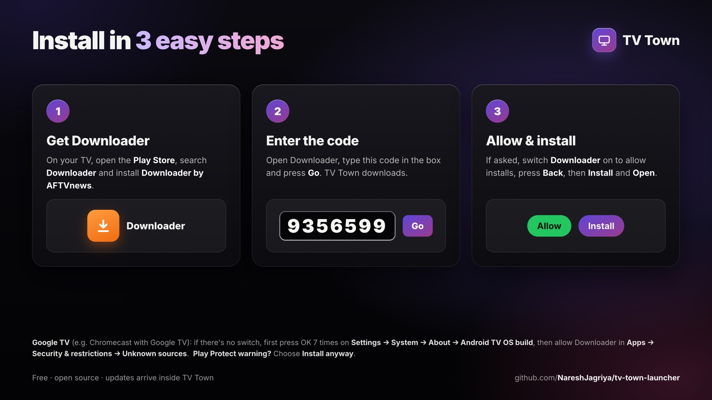

1. **Get Downloader:** on the TV, open the Play Store, search **Downloader** and install **Downloader by AFTVnews**.
2. **Enter the code:** open Downloader, type **9356599** in the box and press **Go**. TV Town downloads (the code always gives the latest version).
3. **Allow the install:** when the TV asks, choose **Settings**, switch **Downloader** on, press **Back**, then **Install**.
   - *Google TV* (e.g. Chromecast with Google TV), if there's no switch: press OK 7 times on *Settings → System → About → Android TV OS build*, then switch Downloader on in *Settings → Apps → Security & restrictions → Unknown sources*.
   - *"Blocked by Play Protect"* or *"Unsafe app"*: choose **More details → Install anyway**. TV Town isn't from the Play Store, so the TV warns.
4. **Follow the Welcome screen:** pick your content style, country and languages, and switch on the *TV Town home helper* so the Home button brings you here.
5. **Optional:** plug in a drive with your films and music, and connect your phone from *Settings → Phone and downloads → Connect my phone*. The first time you use the phone's arrow keys, choose **Allow** and tick *Always allow* on the TV.

## How to add the free API keys

It is optional and free, and you type them on your phone by scanning the QR code on the TV. TV Town works without them, using JustWatch for film details.

| Key | What it adds | Where to get it | Where to add it |
|---|---|---|---|
| **TMDB** | Film and series details, pictures, new titles, Discover and Surprise Me picks | Make a free account at [themoviedb.org](https://www.themoviedb.org/signup), then open *Settings → API* and copy your **API key** | *Customize TV Town → Updates and backup → Films and series info (TMDB key)* |

Weather needs no key: add your town in *Customize TV Town → Home → Weather beside the clock*.

---

## See it by feature

### [Home](FEATURES.md#home)

Full-screen artwork from the apps you actually use. No ads, no sponsored rows.

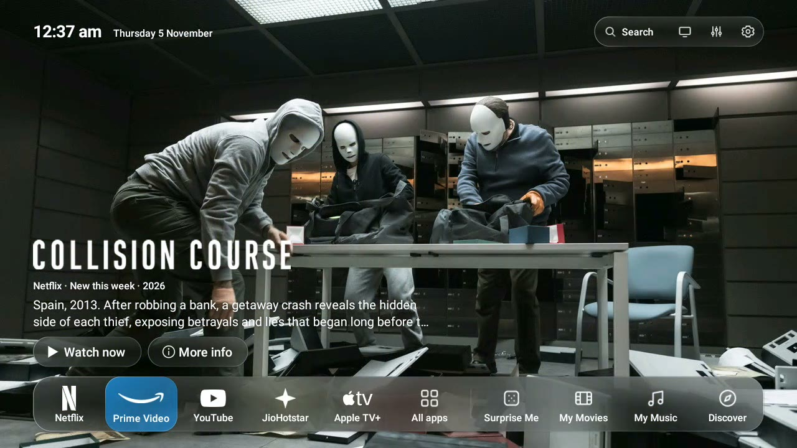

### [Continue Watching](FEATURES.md#continue-watching-and-my-watchlist)

No more opening every app to find where you left off.

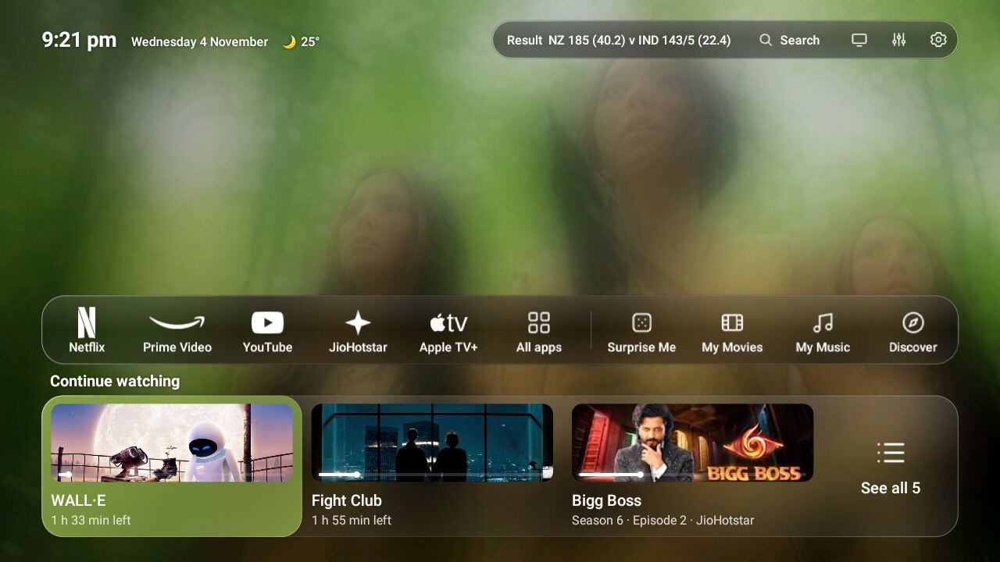

### [Speed Up Your TV](FEATURES.md#speed-up-your-tv)

One press for a faster, cleaner TV. Nothing is uninstalled, and one button undoes it all.

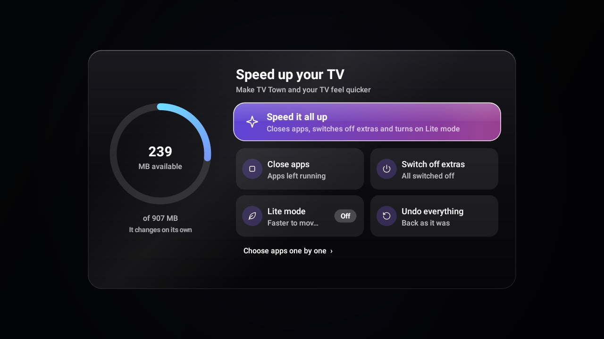

### [Search and the keyboard](FEATURES.md#search)

A keyboard made for the remote, or type from your phone. One search for everything.

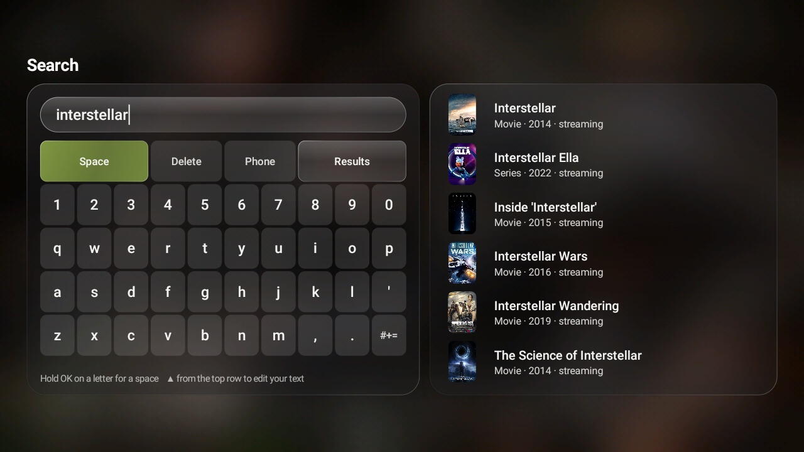

### [My Music and the music player](FEATURES.md#my-music)

Sing along with karaoke-style lyrics and cool visualizer effects.

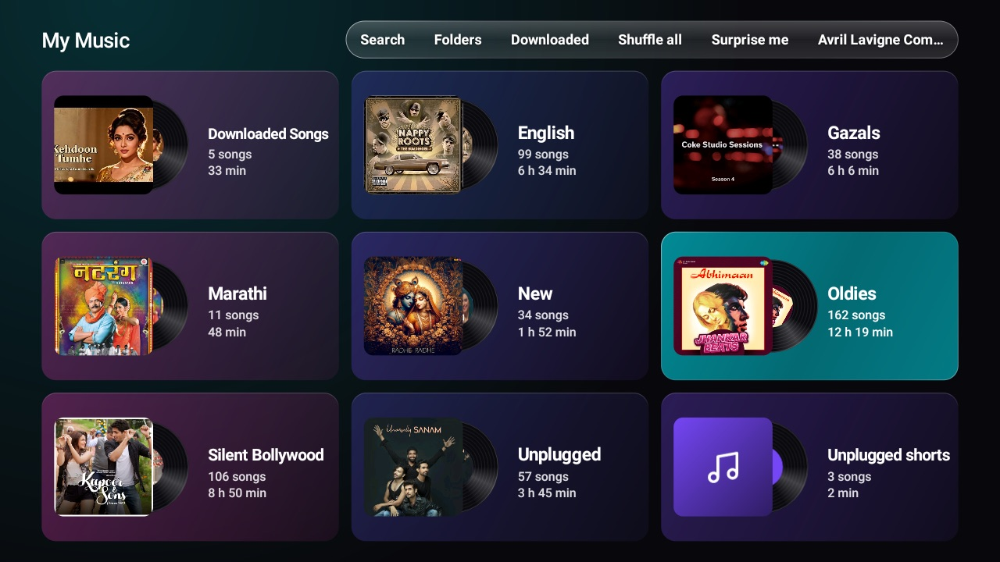


### [Control Center](FEATURES.md#control-center)

Your TV's quick controls, one press away.

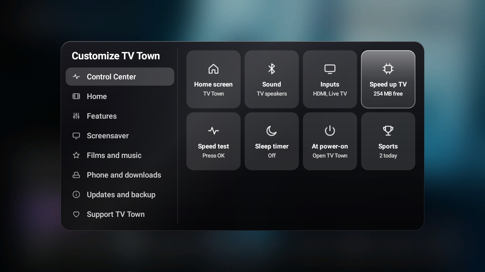

### [My Movies](FEATURES.md#my-movies)

Your own movie collection as a beautiful library.

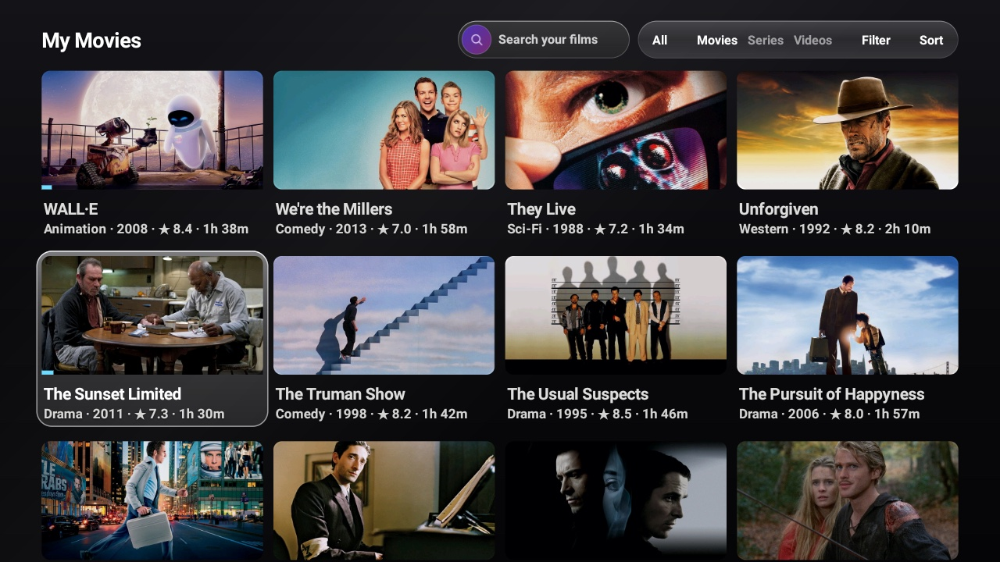

### [Surprise Me](FEATURES.md#surprise-me)

No more "What should we watch tonight?"

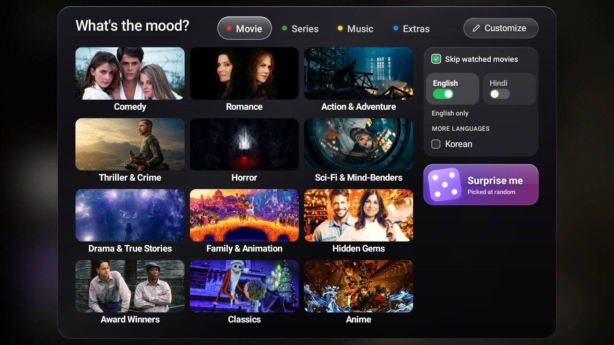

### [Discover](FEATURES.md#discover)

Movies and series from all your streaming apps in one place.

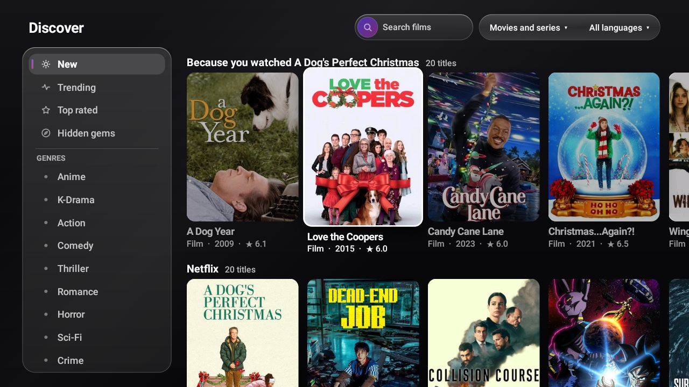

### [Sports](FEATURES.md#control-center-and-sports)

Cricket, football, basketball and tennis, with live scores and full scorecards.

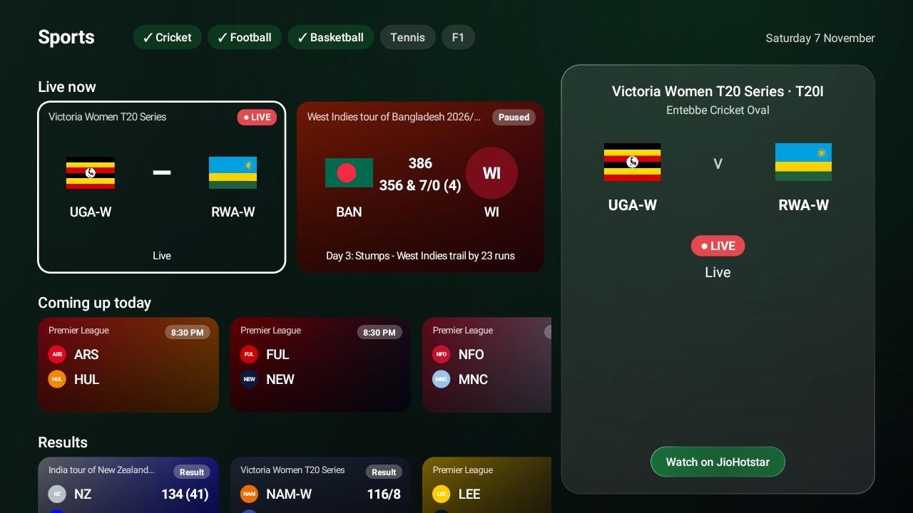

### [Phone remote](FEATURES.md#phone-remote)

No more "pass me the remote!" Your phone is the remote, and a game controller too.

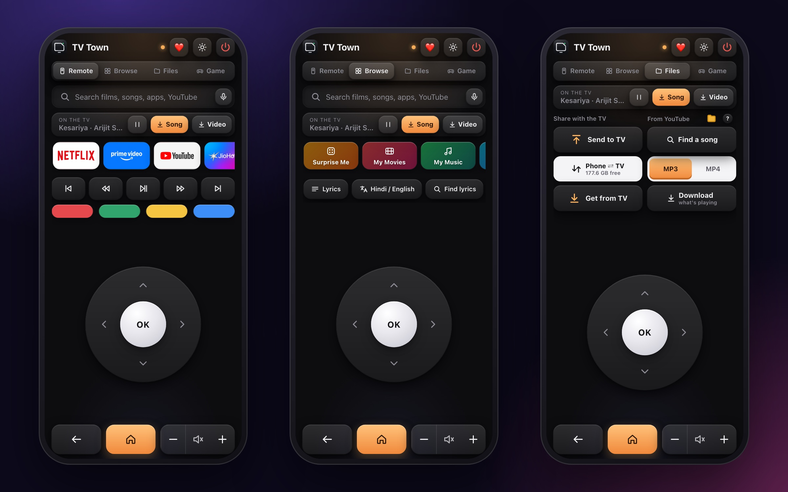

### [YouTube downloads](FEATURES.md#youtube-downloads)

Save what's playing on YouTube to your drive and enjoy it offline.

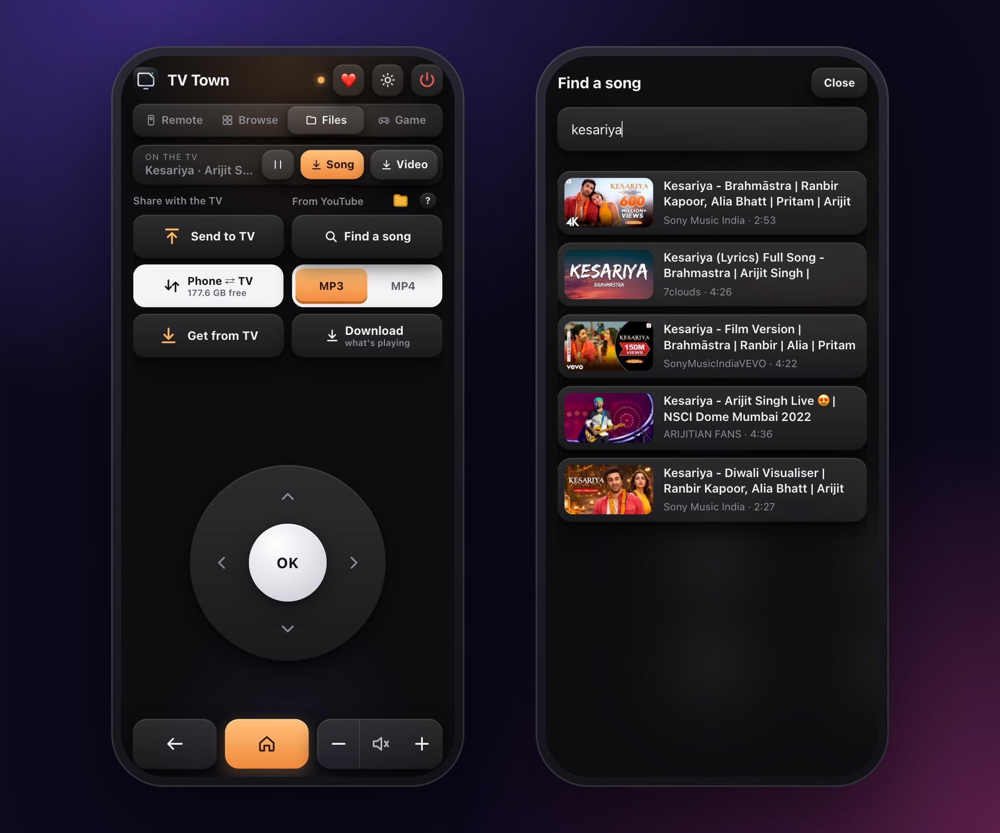

### [Share](FEATURES.md#share)

Songs and films between your phone and your TV, both ways. No cables, no cloud.

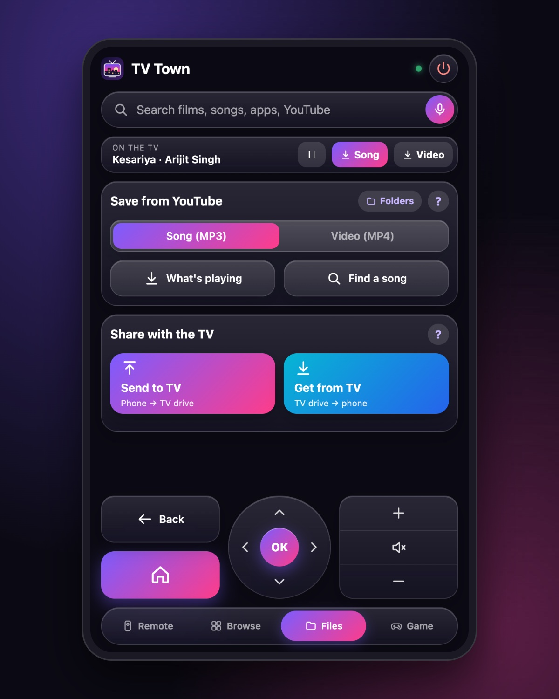

### [Settings](FEATURES.md#settings)

Turn features on or off and set up TV Town exactly the way you like.

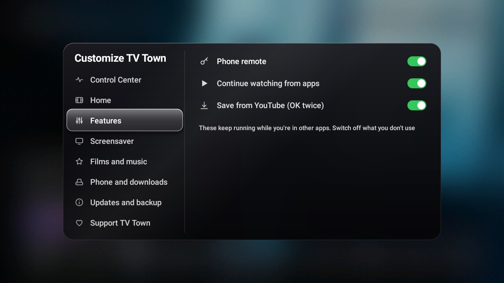

### [Screensaver](FEATURES.md#screensaver)

Something beautiful when nobody's watching.

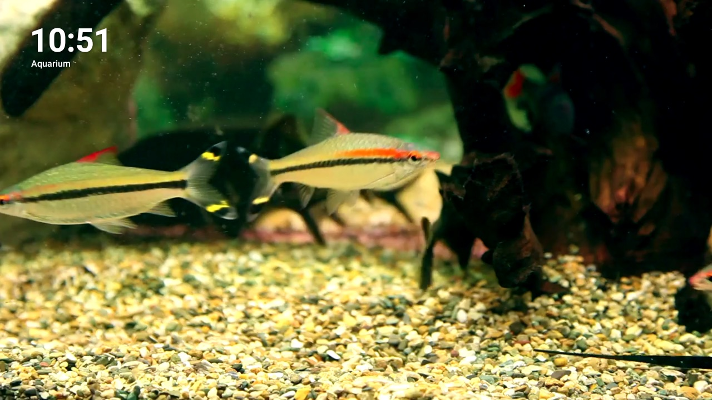

---

## All features

Every feature, with pictures, is in **[FEATURES.md](FEATURES.md)**.

## Remote control

| Where | Key | Does |
|---|---|---|
| Everywhere in TV Town | Arrows | Move to the nearest item that way |
| Home | OK | Opens the app or title |
| Home | Hold OK on an app | App info |
| Home | Back | Closes what is open, else returns to your apps |
| Home | Down from the dock | Continue watching and listening |
| Surprise Me | Left / Right on the tabs | Movie, Series, Music, Extras |
| Lists and rows | CH+ / CH− (or FF / RW) | Jump four |
| My Movies | Number keys while rating | Rate directly (0 = 10) |
| Anywhere | Home | Back to TV Town |

---

## Setting it up for someone else

See **[How to install](#how-to-install)** above, and **[INSTALL.md](INSTALL.md)** for every step. Setting it up for a friend? **[SHARE.md](SHARE.md)** has a message to send them (phone and
TV only).

## Privacy

TV Town has no accounts, no analytics and no ads, and sends no personal data anywhere. See [PRIVACY.md](PRIVACY.md).

---

## For developers

### Build
Requirements: Android Studio (JDK 17+, Android SDK).
```sh
./gradlew assembleRelease            # signed, shrunk release, with your own keys built in (personal)
./gradlew assembleRelease -Ppublic   # the same with no keys or accounts inside, to share
./gradlew testDebugUnitTest          # unit tests
```
- **Signing key:** `~/.tvtown/keystore.properties` and the `.jks` it names. Keep a backup: Android only accepts an
  update signed with the same key.
- **Personal keys:** `~/.tvtown/api.properties` (`tmdb.apiKey=…`). Never committed.

### Mac scripts (development)
With adb and network debugging on the TV:
These are in `scripts/mac/`; double-click one in Finder.

- **Install or Update TV Town.command:** builds, installs, keeps your settings, makes TV Town the home.
- **Apply TV Tune-up.command / Restore Default Home.command:** optional tweaks, and undoing everything.
- **Send to TV.command:** songs, films or background videos to the TV's drive over Wi-Fi.
- **Build for Friends.command:** `dist/TV-Town.apk` with no keys inside, to send to friends (see SHARE.md).

Every change the scripts make is logged with its undo command in `~/.tvtown/tv-changes.log`.

### Releases
Raise `versionCode` / `versionName` in `app/build.gradle`, add the version to `CHANGELOG.md`, then tag it
(`git tag vX.Y && git push origin vX.Y`). The Release workflow tests, builds the public APK, signs it with the key
stored as repository secrets (see the workflow file) and publishes it; TVs find it within a day.

### Project layout
| Path | What it is |
|---|---|
| `HomeView`, `MainActivity` | Home, Settings, Customize, Welcome |
| `RandomSheet`, `Picks`, `Songs` | Surprise Me: cards, picks, music and video search |
| `MyMoviesView`, `MyMovies`, `Tags`, `Tracks`, `FileOps` | My Movies |
| `MyMusicView`, `MyMusic`, `MusicPlayer`, `Lyrics` | My Music and its player |
| `DiscoverActivity`, `MustWatchView`, `Library`, `Awards` | Discover, your watched list and watchlist |
| `TvKeyboard`, `ControlCenter`, `SportsActivity`, `Cricket`, `Scores`, `TvTownDream` | Search, Control Center, Sports, the screensaver |
| `CleanupActivity`, `Cleanup`, `TvShell`, `Lite` | Speed up your TV: what may be switched off, the safe way it is done, and Lite mode |
| `Watched` | Continue watching for other apps |
| `PhoneLink`, `PhoneRemote`, `YtSaver` | The phone remote and downloads |
| `Tmdb`, `JustWatch`, `Catalog`, `DeepLinks`, `Services` | Where titles come from, and opening them in their app |
| `Net`, `ImageCache`, `Work` | HTTPS-only networking with a cache; images; background threads |
| `HomeKeyService`, `ServiceRepair` | The home helper |
| `Updater`, `Backup`, `Weather`, `Style`, `Keys` | Updates, backup, weather, content style and languages, keys |
| `scripts/` | Install, tune-up, restore, send to TV (macOS) |

---

## ❤️ Support TV Town

**Happiness is creating something you love. Even better when someone loves it too!**
Want to make a creator smile? You know what to do. 😁 No pressure! ❤️

| | |
|---|---|
| 🇮🇳 **India (UPI)** | `nareshjagriya@okhdfcbank`, from GPay, PhonePe, Paytm or any bank app. ☕ ₹99 · 🥟 ₹199 · 🍿 ₹499 · 🎬 ₹999 · ✨ any amount |
| 🌍 **Anywhere else** | [paypal.me/jagriya](https://paypal.me/jagriya): ☕ [$3](https://paypal.me/jagriya/3USD) · 🍕 [$5](https://paypal.me/jagriya/5USD) · 🍿 [$10](https://paypal.me/jagriya/10USD) · 🎬 [$25](https://paypal.me/jagriya/25USD) · ✨ [any amount](https://paypal.me/jagriya) |

On the TV it has its own place in **Settings**, with a QR code for your phone.

## The name and logo

The code is free to use, change and share under the licence below. The name **TV Town** and its logo are this project's own: if you publish a changed copy, please give it a different name and logo, so people can tell the two apart.

## Licence

[GNU General Public License, version 3](LICENSE). You can use, change and share it, as long as anything you share stays under the same licence with its source code.
The libraries it ships keep their own licences: see [THIRD_PARTY_NOTICES.md](THIRD_PARTY_NOTICES.md).

Copyright © 2026 Naresh Jagriya. Not affiliated with any streaming service; their names and logos belong to their
owners. This product uses the TMDB API but is not endorsed or certified by TMDB.

What's in this version: [CHANGELOG.md](CHANGELOG.md).
